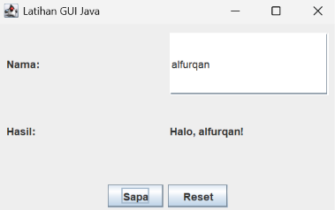

# Latihan GUI Java - PBO

**NIM:** F1D02510139

**Nama:** MUHAMMAD AL FURQAN

## Deskripsi

Program sederhana untuk latihan membuat Graphical User Interface (GUI) menggunakan Java Swing.
Program menampilkan form input nama, tombol untuk menyapa, dan tombol reset.

## 5 Komponen Utama GUI

1. **JFrame** (Top-level Container): jendela utama aplikasi tempat semua komponen diletakkan.
2. **JPanel** (Intermediate Container): wadah di dalam frame untuk mengelompokkan komponen.
3. **JButton, JLabel, JTextField** (Atomic Component): tombol, teks, dan kotak input.
4. **GridLayout, FlowLayout, BorderLayout** (Layout Classes): mengatur posisi komponen di dalam container.
5. **ActionListener & MouseAdapter** (Event Listener): menangani aksi klik tombol dan klik label.

## Screenshot

